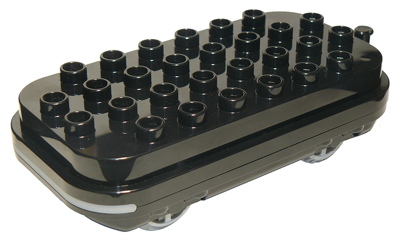
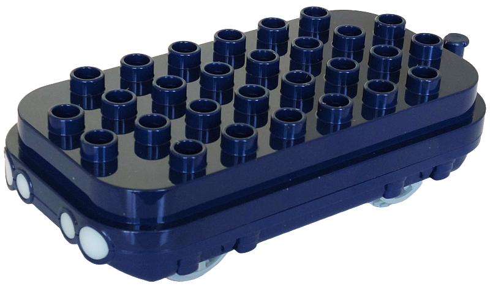
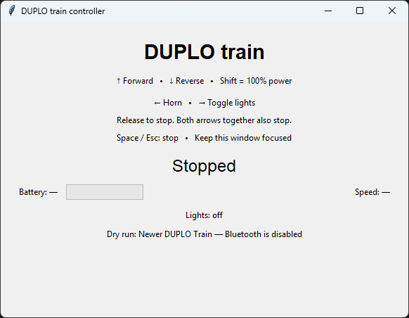

# DUPLO train controller

A Python module for LEGO DUPLO train bases using the
[LEGO Wireless Protocol 3.0.00 (Doc v3.0.00 r17)](https://lego.github.io/lego-ble-wireless-protocol-docs/).
It includes a simple GUI test program for driving a train and viewing telemetry.
An installable Python library is planned.

Currently supports both generations of BLE train base:

| Older base — 2018 | Newer base — 2025 |
| --- | --- |
|  |  |
| Steam Train, Cargo Train, Coding Express | Community Train, Adventure Train |

Requires **Python 3.10+**, **Bleak** for Bluetooth LE, and **Tkinter** for the test
GUI. Tkinter is provided by Python or your OS; it is not installed by pip.

## Run the test program

From the repository root, with your virtual environment activated:

```bash
python -m pip install -r requirements.txt
python src/train_controller.py
```

Switch on the train, close any other app connected to it, and wait for the
connection message. If several trains are available, select one with
`--address` or restrict discovery with `--profile`.

### Window

- **Status:** connection progress, selected base generation, and errors.
- **Direction and throttle:** requested forward/reverse motor power, or stopped.
- **Battery:** percentage and level bar.
- **Speed:** sensor reading with the train's reported unit, or `(raw)` if unavailable.
- **Lights:** last requested on/off state; `—` means unknown.

Throttle is motor power, not a target speed. Missing telemetry shows `—`.

### GUI screenshot

<<<<<<< HEAD
_GUI screenshot to be added._


=======

>>>>>>> 182d405ca3ed4af5c90741d79c812f5a2068f7c5

### Keyboard controls

Keep the controller window focused.

| Key | Action |
| --- | --- |
| Hold Up / Down | Forward / reverse at 50% throttle |
| Hold Shift + Up / Down | Forward / reverse at 100% throttle |
| Press Left | Sound the horn once |
| Press Right | Toggle white lights on/off |
| Release Up/Down, or hold both | Stop |
| Space / Escape | Stop; release the direction keys before driving again |

Switching away from the window requests a stop. Closing it attempts a stop
before disconnecting.

### Command-line arguments

| Argument | Purpose |
| --- | --- |
| `--address ADDRESS` | Select a specific train's Bluetooth address |
| `--profile auto\|old\|new` | Auto-detect (default), or restrict discovery to one generation |
| `--dry-run` | Test the GUI and keys without Bluetooth; print packets to the terminal |
| `-h`, `--help` | Show command-line help |

```bash
python src/train_controller.py --profile old
python src/train_controller.py --address AA:BB:CC:DD:EE:FF
python src/train_controller.py --dry-run --profile new
```

## Documentation

- [BLE reference](docs/TRAIN_BLE_REFERENCE.md): packets, port mappings, and hardware findings.
- [Development notes](docs/DEVELOPMENT.md): environment setup, automated tests, and implementation details.
